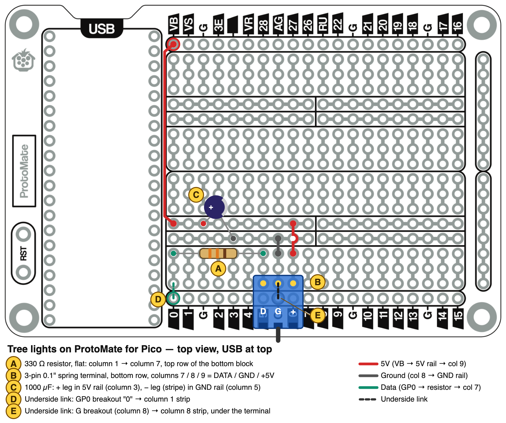

# Tree lights

A Raspberry Pi Pico W drives a string of 200 WS2811 LEDs. Tap the tree on a web page, or press BOOTSEL, to turn the lights on or off. A daily schedule can do it for you, a slider sets the brightness, and new versions can be uploaded over WiFi.

This replaces the original Raspberry Pi and Flask version, which is still in this repo's history. The colours and their order are the same as before.



## Wiring

The string's input end connects to the Pico. The Pico passes USB power through to the lights.

| Pico | String |
|---|---|
| VBUS (pin 40) | 5V |
| GND (pin 38) | GND |
| GP0 (pin 1), through a 330–470 Ω resistor | DATA |

- Put a 1000 µF capacitor across 5V and GND, with the stripe to GND.
- Power the Pico from a 5V USB charger rated 2–3 A, not a laptop port.
- [docs/protomate-layout.png](docs/protomate-layout.png) shows a soldered build on a ProtoMate for Pico, with a 3-pin terminal for the string's pigtail.

## Install

1. Flash MicroPython (tested on 1.22.2) onto the Pico W.
2. Copy `wifi_config.example.py` to `wifi_config.py` and fill in your WiFi name and password. Git ignores this file.
3. Copy the files to the Pico:

```bash
mpremote cp main.py app.py index.html update.html manifest.json icon-192.png icon-512.png wifi_config.py :
```

4. Reset the Pico. It prints its address on the serial console; open `http://<pico-ip>/` on any device on the same network.

Reserve the Pico's IP address in your router so the address doesn't change. You can add the page to a phone's home screen.

## Case

[case/](case/) has a 3D-printable case in two versions, as STL files and the Python scripts that make them:

- **Low profile, 19.6 mm tall:** the board drops onto printed pins, and posts under the lid hold it down. The Pico is soldered on.
- **Screwed, 28 mm tall:** M2.5 screws into standoffs, with the Pico in sockets.

Both have the tree engraved on the lid, a plunger for the BOOTSEL button, and keyholes for hanging. [case/README.md](case/README.md) covers what to measure before printing. The board's measured dimensions are in [case/protomate-dimensions.svg](case/protomate-dimensions.svg).

## Brightness

The slider runs from 20% to 250% of the original colours, which are 100%. Every colour channel is scaled by the same amount, so each colour keeps its tone. The 250% limit keeps the string at about 1.75 A, within what a 2–3 A charger can pass through the Pico.

## Updating over WiFi

After the first install over USB, open `http://<pico-ip>/update` (or tap **Update software** at the bottom of the page).

### From GitHub

Tap **Check for updates**. The Pico compares its files with the release tagged `stable` in this repo, never `master`, and lists any that differ. **Install** downloads them, checks each against the SHA-256 in `release.json`, then swaps them all in. If `app.py` changed, the Pico restarts.

To make a new stable release from your copy of the repo:

```bash
python3 make_release.py
```

```bash
git add -A && git commit -m "Release" && git push
```

```bash
git tag -f stable && git push -f origin stable
```

`make_release.py` writes `release.json` with each Pico file's size and hash. It takes an optional version name and defaults to today's date. Work pushed to `master` doesn't reach the Pico until you move the `stable` tag.

The Pico doesn't verify GitHub's certificate (MicroPython doesn't by default), so on a network you don't trust, someone could feed it other files. The repo is public, so it needs no keys.

### Uploading files yourself

Choose the changed files on the update page, upload them, then restart the Pico. You can also upload from a terminal:

```bash
curl --data-binary @app.py "http://<pico-ip>/api/upload?name=app.py"
```

```bash
curl -X POST http://<pico-ip>/api/restart
```

- Only `app.py`, the pages and the icons can be uploaded. `main.py` and `wifi_config.py` need USB.
- A new `app.py` is checked for syntax errors before it's saved.
- If a new `app.py` doesn't start, `main.py` puts the previous version back and restarts. The error is shown on the update page.
- Anyone on your WiFi can use the update page, the same as the rest of the app.

## Files

| File | What it does |
|---|---|
| `main.py` | Loader: runs `app.py` and rolls back a failed update |
| `app.py` | Lights, BOOTSEL button, schedule, WiFi, clock (UK time) and web server |
| `index.html` | The web page |
| `update.html` | The page for updating from GitHub or uploading files |
| `make_release.py`, `release.json` | Makes and holds the list of files in a stable release |
| `manifest.json`, `icon-*.png` | Home-screen icon |
| `wifi_config.example.py` | Template for your WiFi details |
| `treelights.json` | Saved on/off state and schedule, created on the Pico |

## Troubleshooting

- **Only the first LED lights up:** the Pico is connected to the string's output end. Use the other end.
- **Chrome on Android can't open the page, but other browsers can:** in Android settings, turn Chrome's Nearby devices permission off and on again, then force-stop Chrome.
