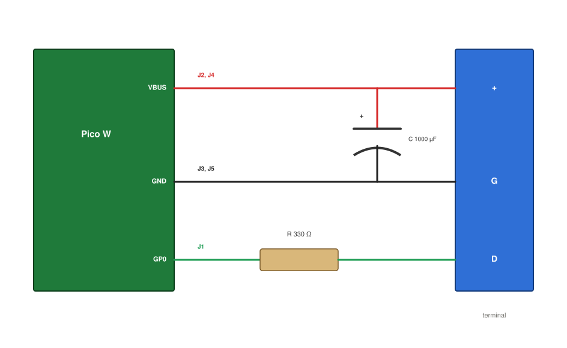
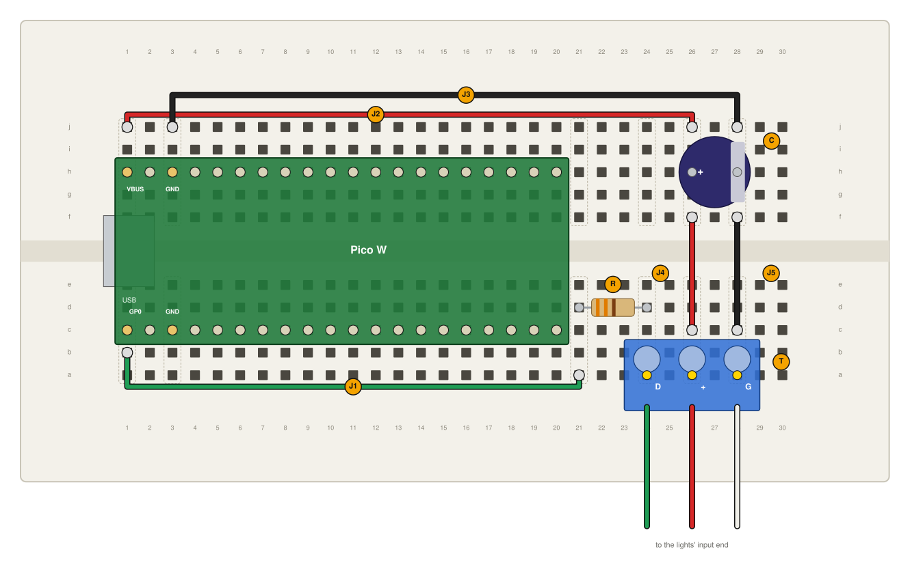

# Tree lights circuit on a breadboard

The same circuit as the ProtoMate board, built on a half-size breadboard (30 columns, rows a–e and f–j) with your second Pico. Use it to check the circuit and the lights work, and to compare against the soldered board.

## The circuit

There are only three connections, plus a capacitor:

- **VBUS → +.** The 5V from the USB socket powers the lights.
- **GND → G.** This is a shared ground. The data signal needs it to work.
- **GP0 → 330 Ω resistor → D.** This is the data signal. The resistor protects the first LED's input.
- **1000 µF capacitor across + and G,** with its + leg on the 5V side. It smooths the supply when the lights switch on.

## How a breadboard is joined

- In each column, holes **a to e** are joined, and holes **f to j** are joined. The two halves aren't joined across the middle gap.
- Nothing is joined left to right. So in the drawing, each dashed outline is one group of joined holes.

## Layout

| Part | From | To |
|---|---|---|
| **Pico** | pins in rows **c** and **h**, columns **1 to 20**, USB end on the left | |
| **J1** data jumper (green) | **1b** (GP0) | **21a** |
| **R** 330 Ω resistor | **21d** | **24d** |
| **T** screw terminal | legs in **24a**, **26a**, **28a** (D, +, G), openings facing the bottom edge | |
| **J2** 5V jumper (red) | **1j** (VBUS) | **26j** |
| **J3** ground jumper (black) | **3j** (GND) | **28j** |
| **C** 1000 µF capacitor | **+ leg in 26h** | **− leg (stripe) in 28h** |
| **J4** 5V across the gap (red) | **26f** | **26c** |
| **J5** ground across the gap (black) | **28f** | **28c** |

With the USB end on the left, the Pico's pins line up with the same labels as the ProtoMate: column 1 is **GP0** on the bottom row and **VBUS** on the top row, and column 3 is **GND** on both.

## Build it

1. Push the Pico in with its pins in rows **c** and **h**, USB end at column 1. That leaves two free holes beside every pin: **a–b** below and **i–j** above.
2. Fit the terminal (**T**) with its legs in row **a**, columns **24, 26 and 28**, so its openings face the bottom edge.
3. Fit the resistor (**R**) from **21d** to **24d**, then **J1** from **1b** to **21a**.
4. Fit **J2** (**1j** to **26j**) and **J3** (**3j** to **28j**).
5. Fit the capacitor (**C**): **+** in **26h**, stripe side in **28h**. Get the polarity right.
6. Fit **J4** (**26f** to **26c**) and **J5** (**28f** to **28c**). These carry 5V and ground across the gap to the terminal.
7. Connect the lights' **input** end: data to **D**, 5V to **+**, ground to **G**.

## Keep the brightness low

Breadboard contacts and thin jumpers are only good for about 1 A. At full brightness, the lights can draw up to about 1.75 A.

- Before you plug in, set the brightness to the lowest setting (20%) in the web app, or choose dim colours.
- Unplug it if a jumper or the breadboard gets warm.

The breadboard is for testing the logic, not for running the lights all evening.

## What the test tells you

- **Lights work on the breadboard:** the lights, their wiring order and the software are all fine. The fault is on the soldered board. Compare the two boards point by point with your multimeter:
  - **0** pad → resistor → **D**
  - **VB** → **+**
  - **G** → **G**
- **Lights don't work on the breadboard either:** the problem is with the lights or how they're connected. Check:
  - you're on the lights' **input** end (arrows, DIN or DI)
  - the order of data, 5V and ground
  - that the second Pico is running the program (open its web page)
- **Swap the Picos.** If one Pico works on the breadboard and the other doesn't, the Pico or its software is the problem.

For the voltage checks, use the same readings as on the soldered board. Between **+** and **G** you should see about 5 V. Between **GP0** or **D** and ground, you should see a flickering 0.3–1.5 V while the lights animate.
