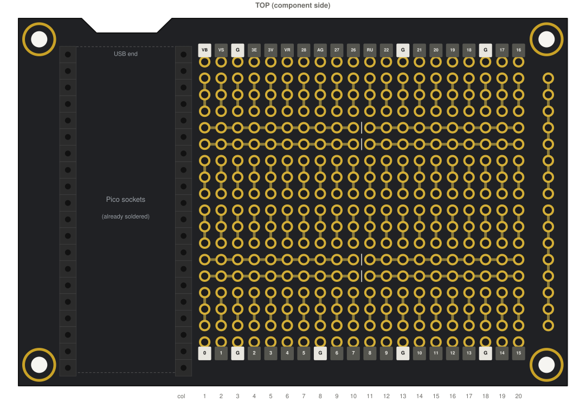
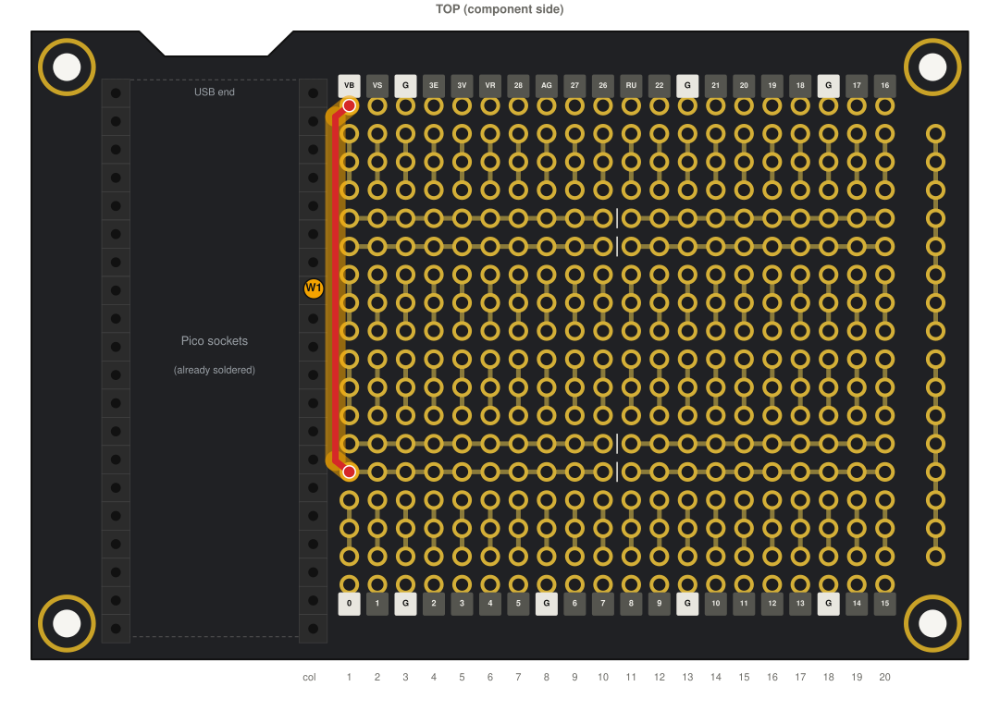
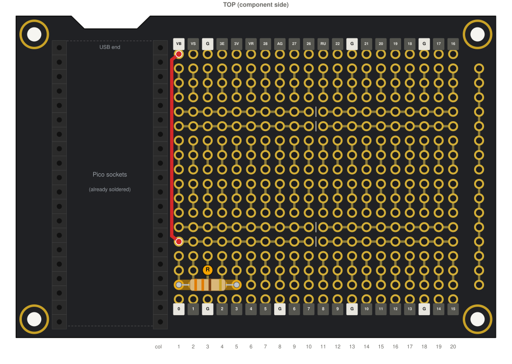
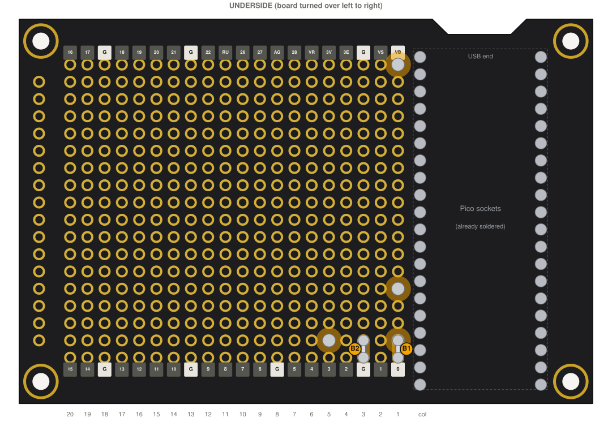
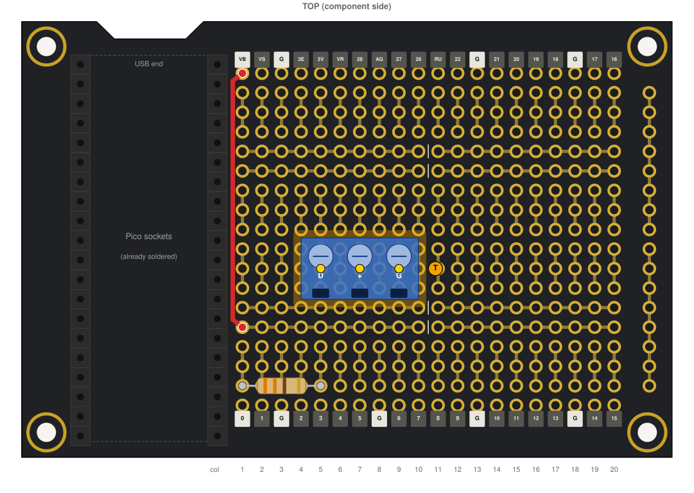
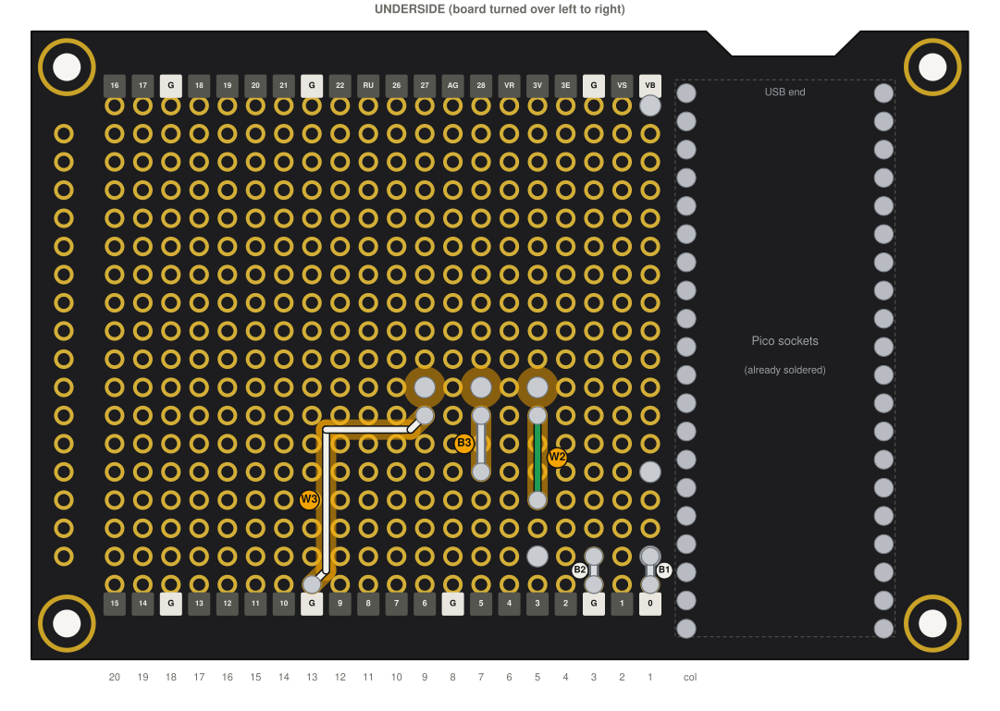
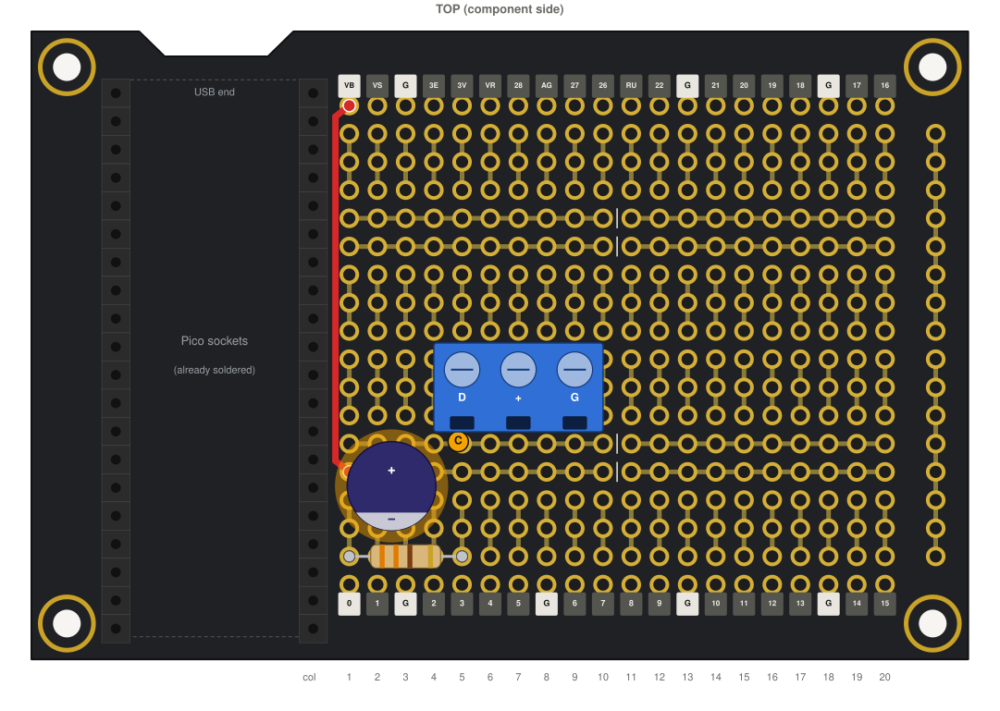
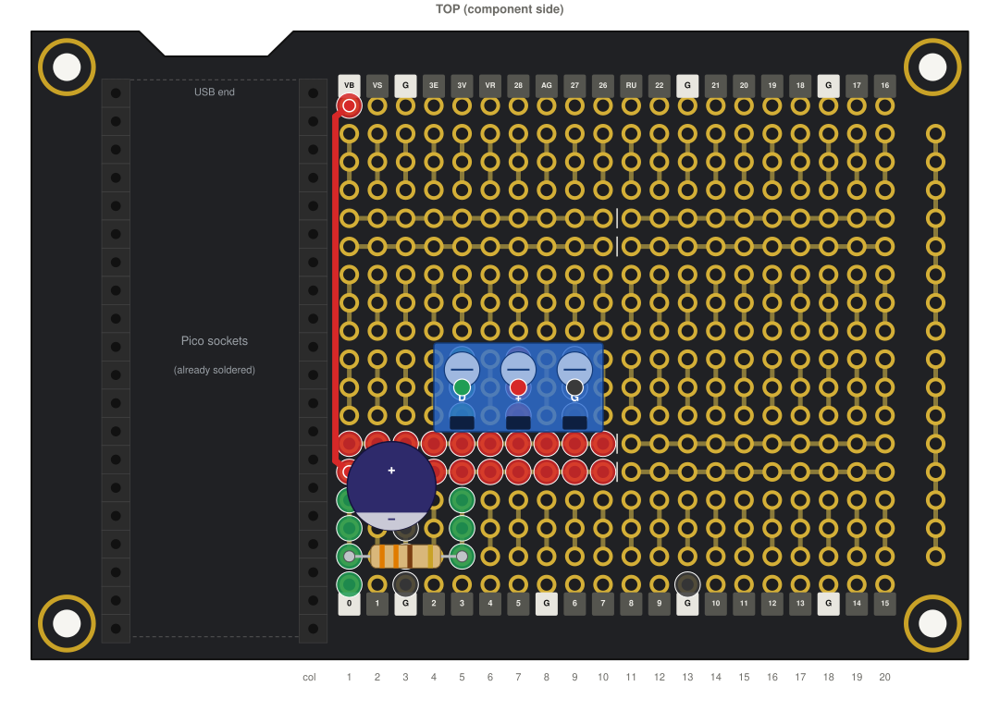
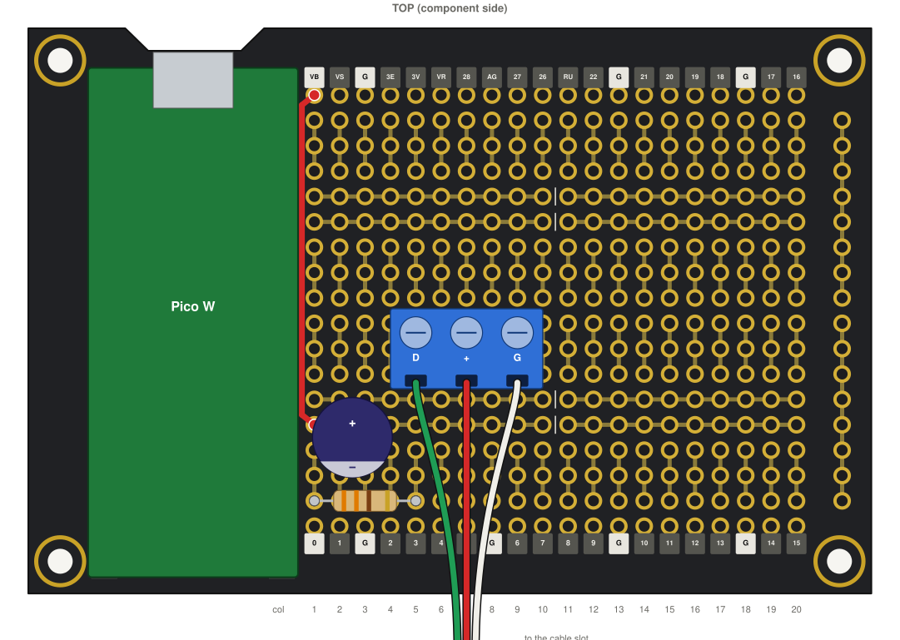

# Building the tree lights board: screw terminal version

This is another way to build the board from [the main guide](BUILD.md). It uses a **3-way screw terminal** (blue, 3 legs in one row, 5.08 mm apart) instead of the six-legged lever terminal.

The terminal sits further back from the case's cable slot, in the block of holes just above the rails, so the wires have room to spread out before they go into it. Everything else is the same as the main guide: the VB wire, the resistor, links B1 and B2, and the data pin (GP0). The capacitor sits one column further left.

Most images show the **top** of the board with the USB end at the top. The **underside** images show the board turned over left to right, so everything is mirrored, the same as when you look at your real board. Amber marks what's new in each step. The numbers under each image are column numbers.

## How to find your way around

- **Columns.** Column 1 is the one with **VB** above it and **0** below it. Count to the right from there (on the underside, count to the left).
- **The bottom block.** These are the three rows of holes just above the bottom edge pads (0, 1, G, 2…). In each column, those three holes are joined. Call them **row 1** (the top one, nearest the rails), **row 2** and **row 3** (nearest the edge pads).
- **The rails.** These are the two long horizontal rows just above the bottom block, left half (columns 1 to 10). The lower one is the **5V rail**. Link B3 joins the **upper rail** to it, so both carry 5V.
- **The terminal block.** This is the block of three-hole strips just above the upper rail. Like the bottom block, each column's three holes are joined. The terminal's legs go in its **middle row**.
- **Edge pads.** Each pad along the top and bottom edges is one of the Pico's pins (0 is GP0, G is ground, VB is VBUS, the 5V from USB). They connect to nothing else unless you link them.
- **Links and wires on the underside.**
  - **Links (B1 to B3)** are short bare wires. Each one lies flat and is soldered onto the outside of joints (see "Making a link" in the main guide). Use the legs you trim off the resistor.
  - **Wires (W2 and W3)** are thin insulated wires laid flat on the underside, soldered only at their two ends. They cross the rails, so they **must** be insulated.

## What you need

- 3-way screw terminal, 5.08 mm pitch
- 330 Ω resistor (orange, orange, brown)
- 1000 µF capacitor, 6.3 V or more, up to about **16 mm** tall upright
- About 100 mm of thin insulated solid-core wire, for W1, W2 and W3
- Masking tape, to hold parts flat while you solder

## Before you start: two things to measure

1. **The terminal's depth,** front to back. The drawings assume about 8 mm. That puts its front face just behind the upper rail. If yours is deeper, it covers some rail holes, which is fine: nothing on the top uses them.
2. **The height of the wire holes,** from the bottom of the terminal to the middle of a hole. The case's cable slot is centred 7 mm above the board and is 6 mm tall, so it covers 4 to 10 mm. If your holes are within that range, the wires will reach. Holes 6 mm up are fine. If not, tell me the measurement and I'll move the slot.

## Converting the lever terminal build

If you've already built the board from the main guide, you only need to **desolder the lever terminal** (all six legs). Everything else can stay:

- **W1, R, B1, B2 and C stay.** In this build the capacitor is one column further left. You can leave it where it is, but it sits closer to the data wire. Move it if the wire is a tight fit.
- **Old links B3, B4 and B5 come loose** when you desolder the terminal, because they're soldered onto its joints. Trim B3 flush at the resistor, B5 flush at the **G** pad, and remove B4 completely, so no bare wire is left on the 5V rail.

Then do steps 4 and 5 below, and the checks in step 7.

---

## Step 0. Starting point

The Pico's sockets are soldered on. Nothing else is fitted yet.

## Step 1. VB wire (W1)

Same as the main guide. This takes the 5V from the Pico's USB socket to the 5V rail.

1. Cut about 60 mm of insulated wire and strip 3 mm from each end.
2. Push one end into the **VB** pad: top edge, column 1.
3. Run the wire down the left edge of the prototyping area, between the Pico sockets and column 1.
4. Push the other end into the **5V rail, column 1** (the lower rail).
5. Bend both ends over on the underside so the wire stays put.

## Step 2. Resistor (R)

1. Bend the resistor's legs so they're 4 holes apart (10 mm).
2. Fit it flat in **row 3 of the bottom block**, from **column 1 to column 5**.
3. Bend the legs out on the underside. **Don't trim the column 1 leg yet**: it makes link B1 in the next step.

## Step 3. Underside: solder, then links B1 and B2

Turn the board over. Column 1 is now on the **right**, next to the Pico sockets.

1. Solder both ends of the VB wire and both resistor legs.
2. **B1 (data from the Pico):** bend the resistor's column 1 leg flat, down onto the **0** pad just below it, and solder it there. Trim off the rest and **keep the piece**.
3. Trim the column 5 leg. Unlike the main guide, you don't need it long.
4. **B2 (ground for the capacitor):** make a link from the piece you kept, from the **G** pad below column 3 up to the column 3, row 3 pad. B2 has nothing to do with the resistor. It brings ground to column 3, ready for the capacitor\'s − leg in step 6. The resistor\'s body passes over column 3 on the top, but its legs are only in columns 1 and 5, so the two never touch.

**Check:** the **0** pad beeps to the resistor's column 1 leg, and the **G** pad beeps to column 3, row 1.

## Step 4. Screw terminal (T)

1. Put the terminal's legs in the **middle row of the terminal block** (just above the upper rail), in **columns 5, 7 and 9**, with the wire openings facing the **bottom edge**.
2. Make sure it sits flat and square, then hold it down with tape.

Its body covers columns 4 to 10 of that block. That's expected. Nothing on the top needs those holes.

Viewed from the front, the contacts are **D (data) · + (5V) · G (ground)**, left to right, the same order as the lever terminal.

## Step 5. Underside: terminal legs, link B3, wires W2 and W3

1. Solder **one** leg first, then check the terminal is still flat. If it isn't, reheat that joint and press it down. Then solder the other two.
2. **B3 (5V to the terminal):** a bare link in **column 7**, from the pad just in front of the **+** leg (the row nearest the rails) across the upper rail to the **5V rail**. Solder it at both ends, and to the upper rail pad it crosses. That joins both rails to 5V, which is fine.
3. **W2 (data to the terminal):** an insulated wire in **column 5**, from **row 1 of the bottom block** (the resistor's strip) to the pad just in front of the **D** leg. Strip 2 mm at each end and poke the ends into the holes. Both are empty. It crosses both rails, and its insulation keeps it off them.
4. **W3 (ground to the terminal):** an insulated wire from the **G** pad below column 13 (between the **9** and **10** pads) to the pad just in front of the **G** leg (column 9). Run it up between columns 12 and 13, then across between the terminal row and the upper rail. Poke the ends into the holes. Any **G** pad works, because they're all the Pico's ground. This one has an empty hole, even on a board converted from the lever terminal.

**Watch for solder bridges:**
- B3 must not touch the column 6 or 8 pads beside it, or it shorts 5V to the strips next to the terminal.
- W2 and W3 cross the 5V rails. If the insulation is damaged or pulled back, they'll short. Make sure only the ends are bare.

## Step 6. Capacitor (C)

This smooths the lights' 5V supply.

1. The capacitor sits diagonally:
   - **+ leg** (the longer one, no stripe) in the **5V rail, column 2**
   - **− leg** (the stripe side) in **column 3, row 1**

   That's one column further left than in the main guide, which keeps it clear of the data wire's path to the terminal. It sits over the end of the VB wire, which is fine.
2. Solder it from the underside and trim the legs.

**Get the polarity right:** an electrolytic capacitor fitted backwards can fail with a pop.

## Step 7. Check it before the Pico goes in

Red is 5V, grey is ground, and green is data. Set your multimeter to beep (continuity) and probe the screw heads, which are connected to the contacts:

| Probe between | Expect |
|---|---|
| Terminal **+** and the **VB** pad | beep |
| Terminal **G** and the **G** pad below column 13 | beep |
| Terminal **D** and the resistor's column 5 end | beep |
| **0** pad and terminal **D** | about 330 Ω on the resistance setting (no beep) |
| Terminal **+** and terminal **G** | **no beep**. A beep means 5V is shorted to ground: find it before going on. |
| Terminal **D** and terminal **+** or **G** | no beep |

The capacitor may beep briefly between + and G while it charges from the meter. A beep that stops after a moment is fine; one that keeps going is a short.

## Step 8. Finish

1. Plug the Pico in, with its USB end at the top.
2. Strip about 6 mm from each of the lights' three wires.
3. Loosen each screw, push a wire into its opening, and tighten the screw. Tug each wire to check it's held. From the front, left to right: **data**, **+5V**, **ground**.
4. Tighten the screws **before** the lid goes on. You can't reach them afterwards.
5. Plug in USB power. The software already uses GP0, so nothing needs changing.

The case's cable slot is centred on column 7, the middle contact, the same as for the lever terminal. The wires have about 15 mm between the slot and the terminal to fan out.
