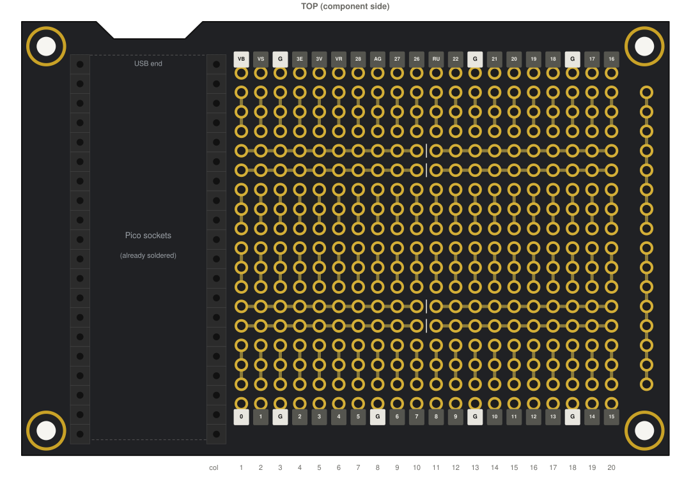
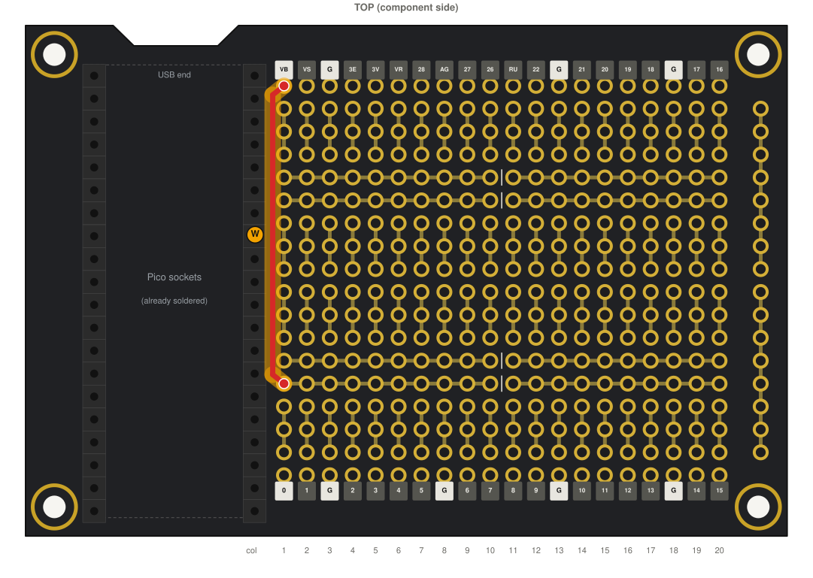
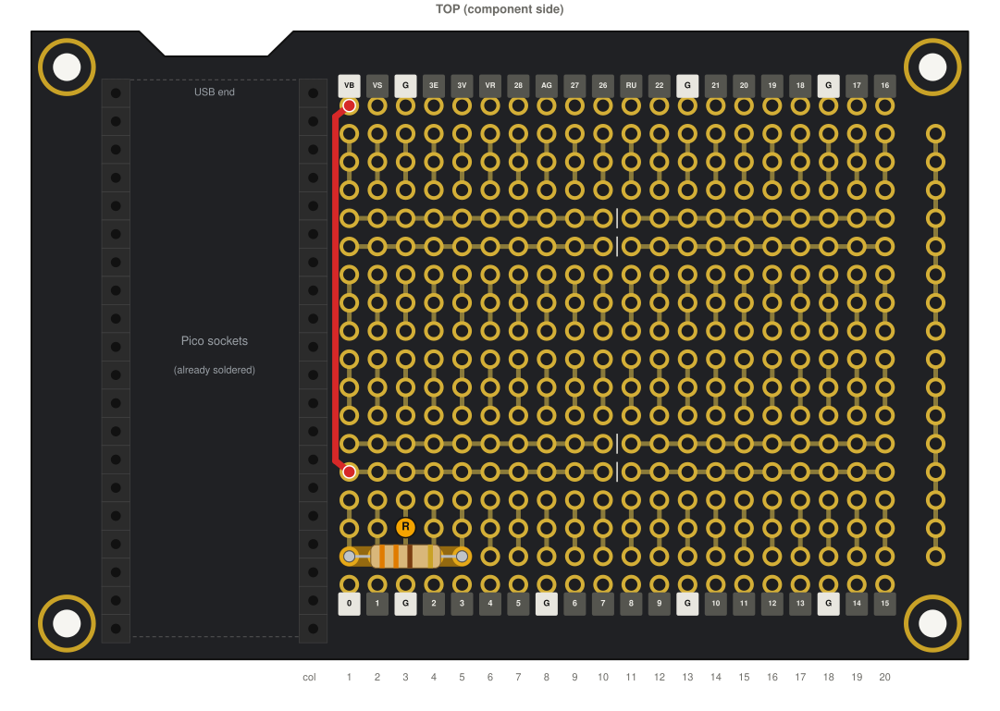
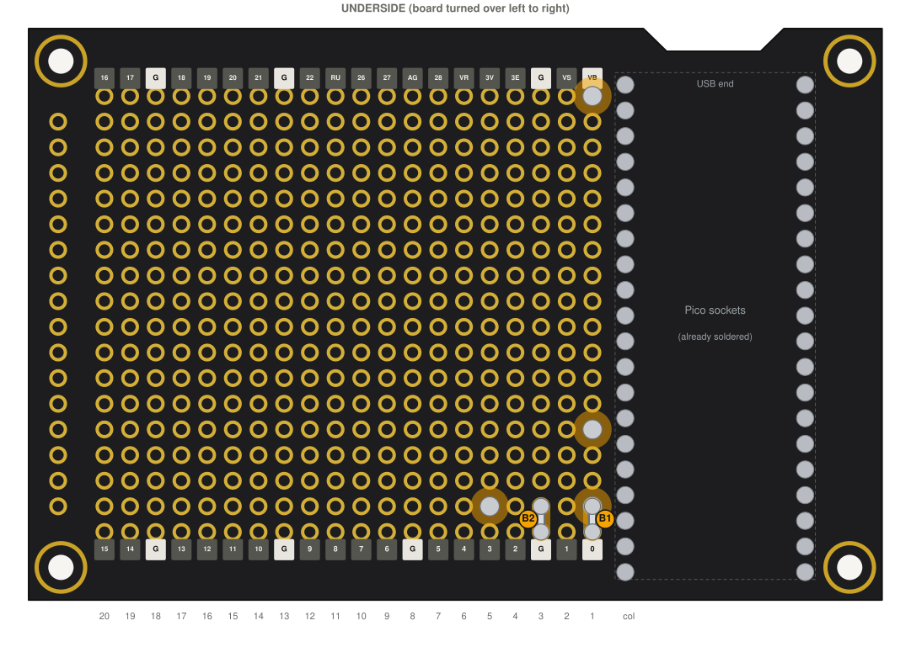
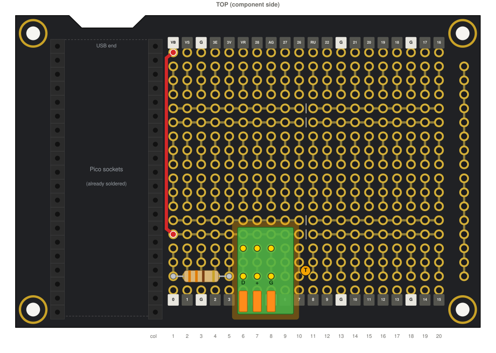
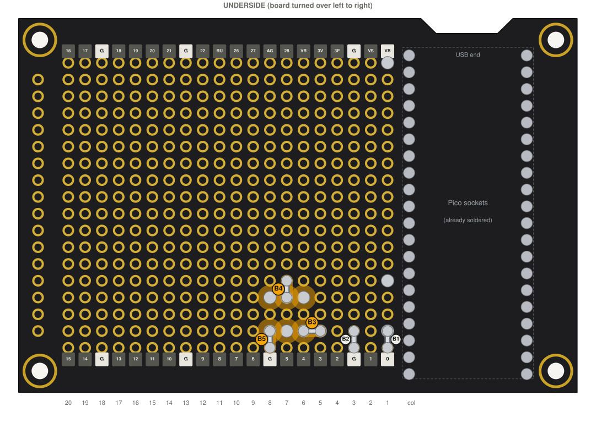
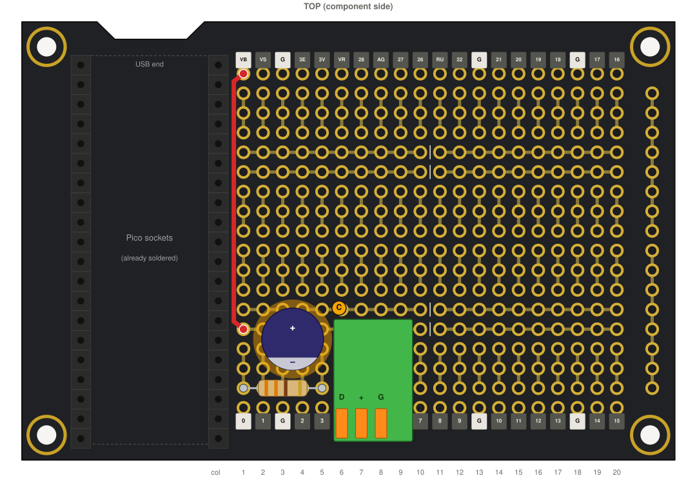
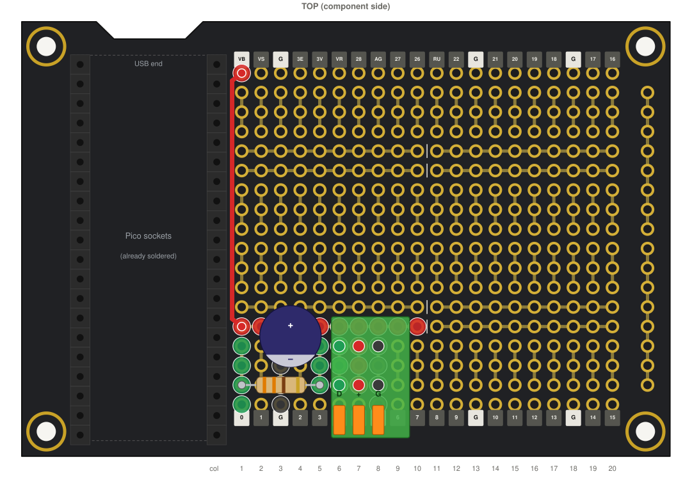
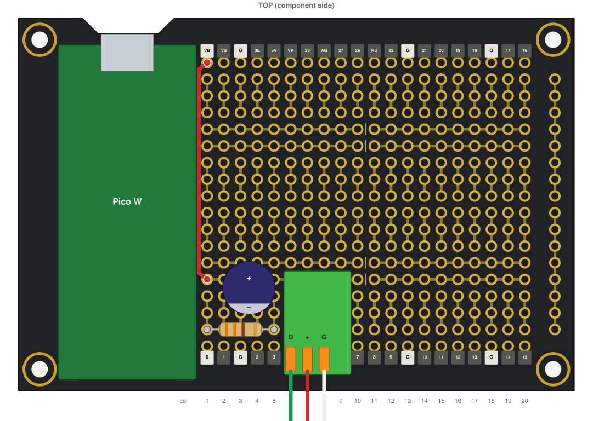

# Building the tree lights board

These steps build the tree lights circuit on a **ProtoMate for Pico**, using the 3-way lever terminal that has **six legs** (two per contact). The terminal keeps all six legs. Every one of them goes into a strip, so none touch the Pico's edge pads.

Most images show the **top** of the board with the USB end at the top. The **underside** images show the board turned over left to right, so everything is mirrored, the same as when you look at your real board. Amber marks what's new in each step. The numbers under each image are column numbers.

## How to find your way around

- **Columns.** Column 1 is the one with **VB** above it and **0** below it. Count to the right from there (on the underside, count to the left).
- **The bottom block.** These are the three rows of holes just above the bottom edge pads (0, 1, G, 2…). In each column, those three holes are joined. Call them **row 1** (the top one, nearest the rails), **row 2** and **row 3** (nearest the edge pads).
- **The 5V rail.** This is the lower of the two long horizontal rows just above the bottom block, left half (columns 1 to 10). This build uses it for 5V. The rail above it isn't used.
- **Edge pads.** Each pad along the top and bottom edges is one of the Pico's pins (0 is GP0, G is ground, VB is VBUS, the 5V from USB). They connect to nothing else unless you link them.
- **Links (B1 to B5).** These are short bare wires on the underside joining two pads that sit next to each other. Use the legs you trim off the resistor and capacitor.

## What you need

- 3-way lever terminal (the six-legged one)
- 330 Ω resistor (orange, orange, brown)
- 1000 µF capacitor, 6.3 V or more. Upright, it can be up to **14 mm** tall. If yours is taller, lay it on its side in step 6.
- About 60 mm of thin insulated solid-core wire, for the VB wire
- Masking tape, to hold parts flat while you solder

## Why this order

- **Lowest parts first.** The wire and resistor go in before the terminal and capacitor. Then the board lies flat while you solder, and nothing gets in the way of your iron.
- **Nothing goes under the terminal on the top.** The terminal covers the holes it sits on, plus the 5V rail holes just above it. So everything on the top goes beside the terminal, not under it. All the terminal's connections are underside links, made after the terminal is soldered, because they join onto its legs.
- **The links next to the edge pads come early (step 3).** They're easier to reach before the terminal and capacitor are on.
- **The Pico goes in last,** after the checks. If anything is shorted, the Pico isn't there to be damaged.

---

## Step 0. Starting point

The Pico's sockets are soldered on. Nothing else is fitted yet. If the terminal is still on the board from before, desolder it first.

## Step 1. VB wire (W)

This takes the 5V from the Pico's USB socket (the **VB** pad) to the 5V rail.

1. Cut about 60 mm of insulated wire and strip 3 mm from each end.
2. Push one end into the **VB** pad: top edge, column 1.
3. Run the wire down the left edge of the prototyping area, between the Pico sockets and column 1.
4. Push the other end into the **5V rail, column 1**.
5. Bend both ends over on the underside so the wire stays put. You'll solder it in step 3.

## Step 2. Resistor (R)

1. Bend the resistor's legs so they're 4 holes apart (10 mm).
2. Fit it flat in **row 3 of the bottom block**, from **column 1 to column 5**.
3. Bend the legs out on the underside. **Don't trim the column 1 leg yet**: it makes link B1 in the next step.

## Step 3. Underside: solder, then links B1 and B2

Turn the board over. Column 1 is now on the **right**, next to the Pico sockets.

1. Solder both ends of the VB wire and both resistor legs.
2. **B1 (data from the Pico):** bend the resistor's column 1 leg down onto the **0** pad just below it, solder it, then trim it.
3. Trim the other resistor leg and keep it.
4. **B2 (ground for the capacitor):** use the trimmed leg as a short link from the **G** pad below column 3 up to the column 3, row 3 pad. Solder both ends.

**Check:** the **0** pad beeps to the resistor's column 1 leg, and the **G** pad beeps to column 3, row 1.

## Step 4. Terminal (T)

1. Put the terminal in **columns 6, 7 and 8**:
   - back legs in **row 1** of the bottom block
   - front legs in **row 3**
   - wire openings (orange levers) facing the **bottom edge**
2. Make sure it sits flat and square, then hold it down with tape.

Its body hangs over to the right and back, covering the holes it sits on, part of column 9, and the 5V rail just behind it. That's expected. Nothing on the top needs those holes.

Viewed from the front, the contacts are **D (data) · + (5V) · G (ground)**, left to right.

## Step 5. Underside: terminal legs, then links B3, B4 and B5

1. Solder **one front leg** first, then check the terminal is still flat. If it isn't, reheat that joint and press the terminal down.
2. Solder the other five legs.
3. **B3 (data to the terminal):** link the resistor's **column 5, row 3** joint to the terminal's **column 6, row 3** leg, right next to it.
4. **B4 (5V to the terminal):** link the terminal's **column 7, row 1** leg to the **5V rail** pad just above it.
5. **B5 (ground to the terminal):** link the terminal's **column 8, row 3** leg to the **G** pad just below it.

**Watch for solder bridges:**
- The back legs in columns 6 and 8 sit right next to 5V rail pads. A bridge there would short data or ground to 5V.
- The front legs in columns 6 and 7 sit next to the **4** and **5** edge pads, which are Pico pins.

## Step 6. Capacitor (C)

This smooths the lights' 5V supply.

1. The capacitor sits diagonally:
   - **+ leg** (the longer one, no stripe) in the **5V rail, column 4**
   - **− leg** (the stripe side) in **column 3, row 1**

   The holes are about 3.6 mm apart, which suits most 8 mm capacitors. Bend the legs slightly if yours are 2.5 or 5 mm apart.
2. If it's taller than 14 mm, lay it on its side, pointing towards the USB end, before you solder. The case lid is 16 mm above the board.
3. Solder it from the underside and trim the legs.

**Get the polarity right:** an electrolytic capacitor fitted backwards can fail with a pop.

## Step 7. Check it before the Pico goes in

Red is 5V, grey is ground, and green is data. Set your multimeter to beep (continuity):

| Probe between | Expect |
|---|---|
| Terminal **+** and the **VB** pad | beep |
| Terminal **G** and any **G** pad | beep |
| Terminal **D** and the resistor's column 5 end | beep |
| **0** pad and terminal **D** | about 330 Ω on the resistance setting (no beep) |
| Terminal **+** and terminal **G** | **no beep**. A beep means 5V is shorted to ground: find it before going on. |
| Terminal **D** and terminal **+** or **G** | no beep |
| Edge pads **4**, **5** and **6** and any terminal contact | no beep |

The capacitor may beep briefly between + and G while it charges from the meter. A beep that stops after a moment is fine; one that keeps going is a short.

## Step 8. Finish

1. Plug the Pico in, with its USB end at the top.
2. Strip about 6 mm from each of the lights' three wires.
3. Hold each lever down, push a wire in, then let go. From the front, left to right: **data**, **+5V**, **ground**.
4. Plug in USB power. The software already uses GP0, so nothing needs changing.

The case's cable slot is centred on the middle contact (column 7) and is 10 mm wide, so it lines up with all three wire openings.

---

## Other places this terminal fits

It fits wherever both rows of legs land in the **same 3-hole strips**: the top and bottom holes (rows 1 and 3) of any block, across three neighbouring columns. It doesn't work anywhere one row of legs would go into the edge pads, a rail, or the long strips down the right-hand side, because those would join contacts together or connect them to Pico pins.

- **Bottom block, columns 6 to 8 (used here).** It's right next to the case's cable slot. The **G** pad below column 8 gives ground with one short link. The resistor and capacitor fit beside it.
- **Top block, columns 1 to 3, openings facing the USB end.** The front legs would sit right next to the **VB** pad (column 1) and a **G** pad (column 3). Power and ground would each be one tiny link, with no VB wire. The middle contact, column 2, would be data, and it must *not* be linked to the **VS** pad beside it. The lights cable would leave next to the USB cable. The case would need its slot moved to the USB end and the keyholes turned round. It's a neat option if you'd like both cables on one side.
- **The two middle blocks.** It fits, but the wires would have to cross the board to reach a wall. Not worth it.
